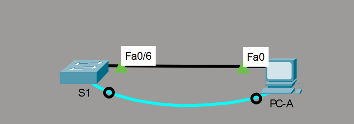
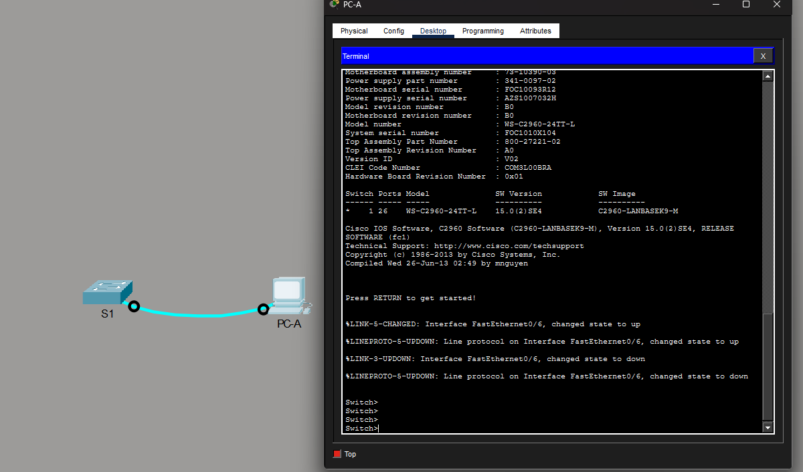
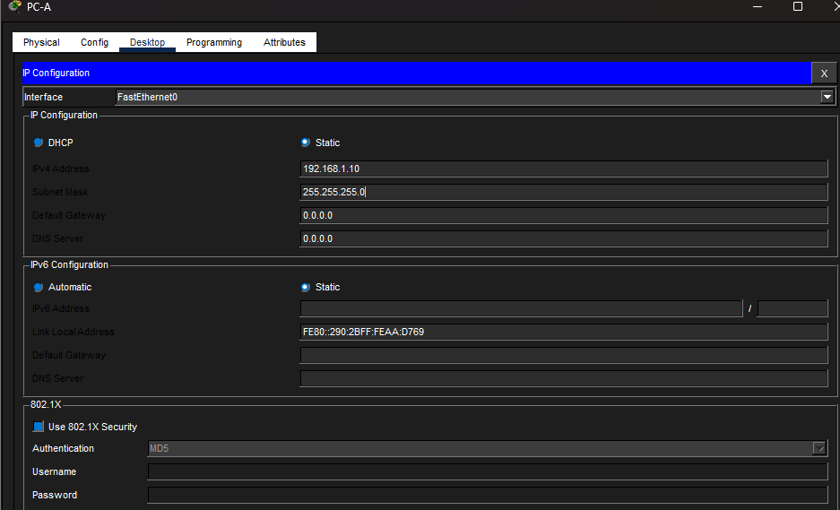
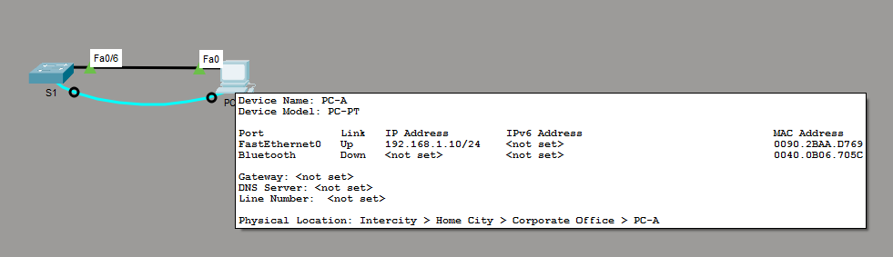
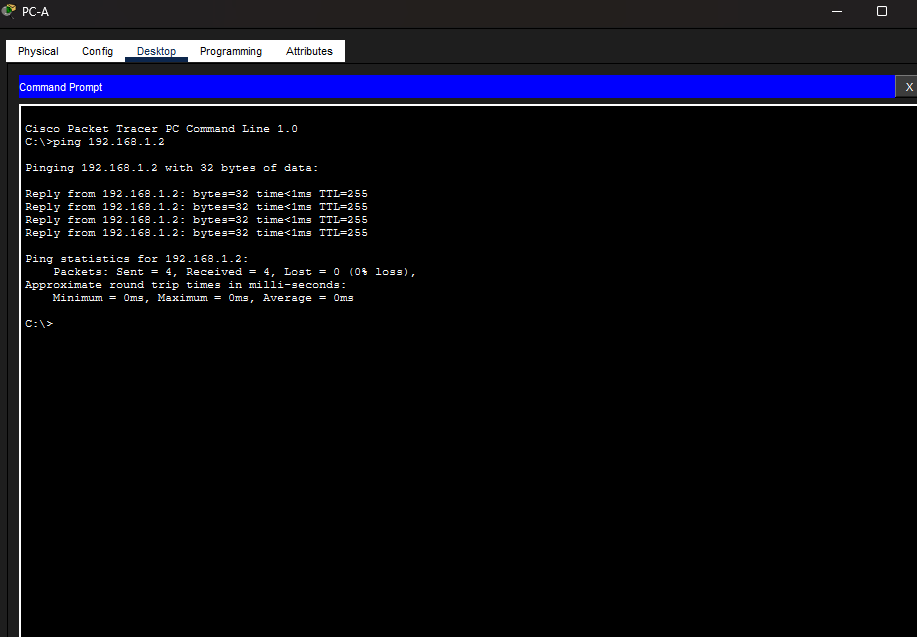
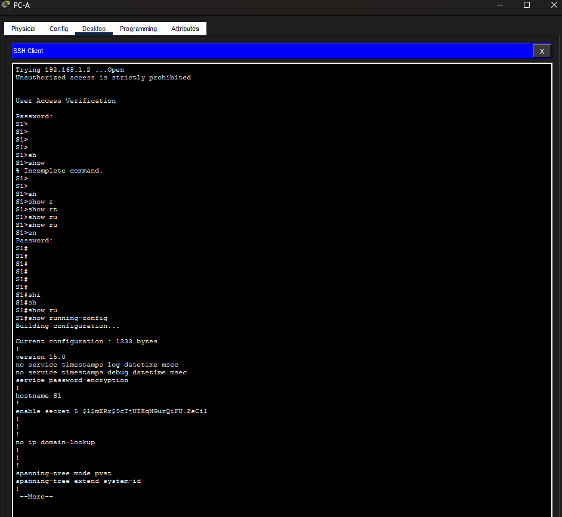

#  Базовая настройка коммутатора

## Топология:

## Таблица адресации.

| Устройство     | Интерфейс   | IP-адрес / префикс            |
|---------------:|:------------|------------------------------:|
| S1             | VLAN 1      | 192.168.1.2 /24               | 
| PC-A           | NIC         | 192.168.1.10 /24              | 

###  	Задачи:

  1. [Проверка конфигурации коммутатора по умолчанию;](readme.md#проверка-конфигурации-коммутатора-по-умолчанию)
  2. [Создание сети и настройка основных параметров устройства;](readme.md#%D1%81%D0%BE%D0%B7%D0%B4%D0%B0%D0%BD%D0%B8%D0%B5-%D1%81%D0%B5%D1%82%D0%B8-%D0%B8-%D0%BD%D0%B0%D1%81%D1%82%D1%80%D0%BE%D0%B9%D0%BA%D0%B0-%D0%BE%D1%81%D0%BD%D0%BE%D0%B2%D0%BD%D1%8B%D1%85-%D0%BF%D0%B0%D1%80%D0%B0%D0%BC%D0%B5%D1%82%D1%80%D0%BE%D0%B2-%D1%83%D1%81%D1%82%D1%80%D0%BE%D0%B9%D1%81%D1%82%D0%B2%D0%B0)
      -	[Настройте базовые параметры коммутатора;](readme.md#%D0%BD%D0%B0%D1%81%D1%82%D1%80%D0%BE%D0%B9%D1%82%D0%B5-%D0%B1%D0%B0%D0%B7%D0%BE%D0%B2%D1%8B%D0%B5-%D0%BF%D0%B0%D1%80%D0%B0%D0%BC%D0%B5%D1%82%D1%80%D1%8B-%D0%BA%D0%BE%D0%BC%D0%BC%D1%83%D1%82%D0%B0%D1%82%D0%BE%D1%80%D0%B0)
      - [Настройте IP-адрес для ПК;](readme.md#%D0%BD%D0%B0%D1%81%D1%82%D1%80%D0%BE%D0%B9%D1%82%D0%B5-ip-%D0%B0%D0%B4%D1%80%D0%B5%D1%81-%D0%B4%D0%BB%D1%8F-%D0%BF%D0%BA)
  3. [Проверка сетевых подключений;](readme.md#%D0%BF%D1%80%D0%BE%D0%B2%D0%B5%D1%80%D0%BA%D0%B0-%D1%81%D0%B5%D1%82%D0%B5%D0%B2%D1%8B%D1%85-%D0%BF%D0%BE%D0%B4%D0%BA%D0%BB%D1%8E%D1%87%D0%B5%D0%BD%D0%B8%D0%B9)
      -	[Отобразите конфигурацию устройства;](readme.md#%D0%BE%D1%82%D0%BE%D0%B1%D1%80%D0%B0%D0%B7%D0%B8%D1%82%D0%B5-%D0%BA%D0%BE%D0%BD%D1%84%D0%B8%D0%B3%D1%83%D1%80%D0%B0%D1%86%D0%B8%D1%8E-%D0%BA%D0%BE%D0%BC%D0%BC%D1%83%D1%82%D0%B0%D1%82%D0%BE%D1%80%D0%B0)
      - [Протестируйте сквозное соединение, отправив эхо-запрос;](readme.md#%D0%BF%D1%80%D0%BE%D1%82%D0%B5%D1%81%D1%82%D0%B8%D1%80%D1%83%D0%B9%D1%82%D0%B5-%D1%81%D0%BA%D0%B2%D0%BE%D0%B7%D0%BD%D0%BE%D0%B5-%D1%81%D0%BE%D0%B5%D0%B4%D0%B8%D0%BD%D0%B5%D0%BD%D0%B8%D0%B5-%D0%BE%D1%82%D0%BF%D1%80%D0%B0%D0%B2%D0%B8%D0%B2-%D1%8D%D1%85%D0%BE-%D0%B7%D0%B0%D0%BF%D1%80%D0%BE%D1%81)
      - [Протестируйте возможности удаленного управления с помощью Telnet;](readme.md#%D0%BF%D1%80%D0%BE%D0%B2%D0%B5%D1%80%D1%8C%D1%82%D0%B5-%D1%83%D0%B4%D0%B0%D0%BB%D0%B5%D0%BD%D0%BD%D0%BE%D0%B5-%D1%83%D0%BF%D1%80%D0%B0%D0%B2%D0%BB%D0%B5%D0%BD%D0%B8%D0%B5-%D0%BA%D0%BE%D0%BC%D0%BC%D1%83%D1%82%D0%B0%D1%82%D0%BE%D1%80%D0%BE%D0%BC-s1)

###  Проверка конфигурации коммутатора по умолчанию:

~~~
enable
  show running-configure
~~~
~~~
Building configuration...

Current configuration : 1080 bytes
!
version 15.0
no service timestamps log datetime msec
no service timestamps debug datetime msec
no service password-encryption
!
hostname Switch
!
!
!
!
!
!
spanning-tree mode pvst
spanning-tree extend system-id
!
interface FastEthernet0/1
!
interface FastEthernet0/2
!
interface FastEthernet0/3
!
interface FastEthernet0/4
!
interface FastEthernet0/5
!
interface FastEthernet0/6
!
interface FastEthernet0/7
!
interface FastEthernet0/8
!
interface FastEthernet0/9
!
interface FastEthernet0/10
!
interface FastEthernet0/11
!
interface FastEthernet0/12
!
interface FastEthernet0/13
!
interface FastEthernet0/14
!
interface FastEthernet0/15
!
interface FastEthernet0/16
!
interface FastEthernet0/17
!
interface FastEthernet0/18
!
interface FastEthernet0/19
!
interface FastEthernet0/20
!
interface FastEthernet0/21
!
interface FastEthernet0/22
!
interface FastEthernet0/23
!
interface FastEthernet0/24
!
interface GigabitEthernet0/1
!
interface GigabitEthernet0/2
!
interface Vlan1
 no ip address
 shutdown
!
!
!
!
line con 0
!
line vty 0 4
 login
line vty 5 15
 login
!
!
!
!
end
~~~

### Создание сети и настройка основных параметров устройства;

#### Настройте базовые параметры коммутатора;

 ##### В режиме глобальной конфигурации скопируйте следующие базовые параметры конфигурации и вставьте их в файл на коммутаторе.

~~~
Switch>clear
Translating "clear"...domain server (255.255.255.255) % Name lookup aborted
Switch>en
Switch#no ip
Switch#no ip do
Switch#no ip dom
Switch#no ip doma
Switch#no ip doma?
% Unrecognized command
Switch#conf t
Enter configuration commands, one per line.  End with CNTL/Z.
Switch(config)#n
Switch(config)#no ip do
Switch(config)#no ip dom
Switch(config)#no ip dom?
domain  domain-lookup  domain-name  
Switch(config)#no ip domain0l
Switch(config)#no ip domain-lo
Switch(config)#no ip domain-lookup 
Switch(config)#ho
Switch(config)#hostname S1
S1(config)#ser
S1(config)#service pas
S1(config)#service password-encryption 
S1(config)#ena
S1(config)#enable se
S1(config)#enable secret class
S1(config)#bann
S1(config)#banner 
S1(config)#banner motd #
Enter TEXT message.  End with the character '#'.
Unauthorized access is strictly prohibited #

S1(config)#
~~~

##### Назначить IP-адрес интерфейсу VLAN 1

~~~
S1(config)#log
S1(config)#logging s
S1(config)#logging sy
S1(config)#logging ?
  A.B.C.D   IP address of the logging host
  buffered  Set buffered logging parameters
  console   Set console logging parameters
  host      Set syslog server IP address and parameters
  on        Enable logging to all enabled destinations
  trap      Set syslog server logging level
S1(config)#li
S1(config)#line con
S1(config)#line console 0
S1(config-line)#logg
S1(config-line)#logging s
S1(config-line)#logging synchronous 
S1(config-line)#exit
S1(config)#in
S1(config)#interface vl
S1(config)#interface vlan 1
S1(config-if)#ip
S1(config-if)#ip af
S1(config-if)#ip ad
S1(config-if)#ip address 192.168.1.2 255.255.255.0
S1(config-if)#no
S1(config-if)#no sh
S1(config-if)#no shutdown 

S1(config-if)#
%LINK-3-UPDOWN: Interface Vlan1, changed state to down

%LINEPROTO-5-UPDOWN: Line protocol on Interface Vlan1, changed state to up

S1(config-if)#
S1(config-if)#

~~~

##### Доступ через порт консоли также следует ограничить с помощью пароля.

~~~
S1(config)#li
S1(config)#line cco
S1(config)#line co
S1(config)#line console 0
S1(config-line)#pas
S1(config-line)#password cisco
S1(config-line)#lo
S1(config-line)#lo
% Ambiguous command: "lo"
S1(config-line)#log
S1(config-line)#log?
logging  login  
S1(config-line)#logi
S1(config-line)#login 
S1(config-line)#li
S1(config-line)#lin
S1(config-line)#line vty 0 4
S1(config-line)#pas
S1(config-line)#password cisco
S1(config-line)#log
S1(config-line)#login
S1(config-line)#login 
S1(config-line)#tra
S1(config-line)#transport in
S1(config-line)#transport input all
S1(config-line)#line vty 5 8
S1(config-line)#tra
S1(config-line)#transport in
S1(config-line)#transport input ssh
S1(config-line)#ser
S1(config-line)#serv
S1(config-line)#exit
S1(config)#ser
S1(config)#end
~~~

#### Настройте IP-адрес для ПК.

### Проверка сетевых подключений:

#### Отобразите конфигурацию коммутатора

~~~
Unauthorized access is strictly prohibited 

User Access Verification

Password: 
S1>sh
S1>show r
S1>show ru
S1>en
S1>enable 
Password: 
S1#
S1#
S1#
S1#
S1#
S1#sh
S1#show r
S1#show running-config 
Building configuration...

Current configuration : 1333 bytes
!
version 15.0
no service timestamps log datetime msec
no service timestamps debug datetime msec
service password-encryption
!
hostname S1
!
enable secret 5 $1$mERr$9cTjUIEqNGurQiFU.ZeCi1
!
!
!
no ip domain-lookup
!
!
!
spanning-tree mode pvst
spanning-tree extend system-id
!
interface FastEthernet0/1
!
interface FastEthernet0/2
!
interface FastEthernet0/3
!
interface FastEthernet0/4
!
interface FastEthernet0/5
!
interface FastEthernet0/6
!
interface FastEthernet0/7
!
interface FastEthernet0/8
!
interface FastEthernet0/9
!
interface FastEthernet0/10
!
interface FastEthernet0/11
!
interface FastEthernet0/12
!
interface FastEthernet0/13
!
interface FastEthernet0/14
!
interface FastEthernet0/15
!
interface FastEthernet0/16
!
interface FastEthernet0/17
!
interface FastEthernet0/18
!
interface FastEthernet0/19
!
interface FastEthernet0/20
!
interface FastEthernet0/21
!
interface FastEthernet0/22
!
interface FastEthernet0/23
!
interface FastEthernet0/24
!
interface GigabitEthernet0/1
!
interface GigabitEthernet0/2
!
interface Vlan1
 ip address 192.168.1.2 255.255.255.0
!
banner motd ^C
Unauthorized access is strictly prohibited ^C
!
!
!
line con 0
 password 7 0822455D0A16
 logging synchronous
 login
!
line vty 0 4
 password 7 0822455D0A16
 login
line vty 5 8
 login
 transport input ssh
line vty 9 15
 login
!
!
!
!
end

~~~

#### Протестируйте сквозное соединение, отправив эхо-запрос.

####  Проверьте удаленное управление коммутатором S1.

