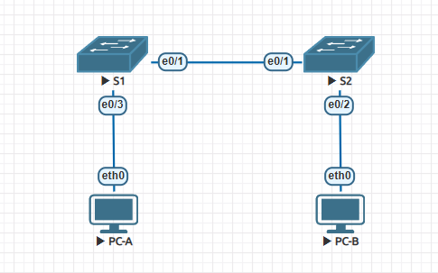
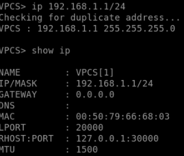
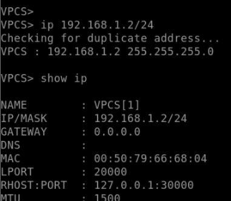

#  Просмотр таблицы MAC-адресов коммутатора 
## Топология:

## Таблица адресации.

| Устройство     | Интерфейс   | IP-адрес / префикс            | Маска подсети                 |
|---------------:|:------------|------------------------------:|------------------------------:|
| S1             | VLAN 1      | 192.168.1.11/24              | 255.255.255.0                 | 
| S2             | VLAN 1      | 192.168.1.12/24              | 255.255.255.0                 | 
| PC-A           | NIC         | 192.168.1.1/24               | 255.255.255.0                 | 
| PC-B           | NIC         | 192.168.1.2/24               | 255.255.255.0                 | 

###  	Задачи:

  1. [Создание и настройка сети;](readme.md#создание-и-настройка-сети)
  2. [Изучение таблицы МАС-адресов коммутатора;](readme.md#%D1%81%D0%BE%D0%B7%D0%B4%D0%B0%D0%BD%D0%B8%D0%B5-%D1%81%D0%B5%D1%82%D0%B8-%D0%B8-%D0%BD%D0%B0%D1%81%D1%82%D1%80%D0%BE%D0%B9%D0%BA%D0%B0-%D0%BE%D1%81%D0%BD%D0%BE%D0%B2%D0%BD%D1%8B%D1%85-%D0%BF%D0%B0%D1%80%D0%B0%D0%BC%D0%B5%D1%82%D1%80%D0%BE%D0%B2-%D1%83%D1%81%D1%82%D1%80%D0%BE%D0%B9%D1%81%D1%82%D0%B2%D0%B0)
      -	[Настройте базовые параметры коммутатора;](readme.md#%D0%BD%D0%B0%D1%81%D1%82%D1%80%D0%BE%D0%B9%D1%82%D0%B5-%D0%B1%D0%B0%D0%B7%D0%BE%D0%B2%D1%8B%D0%B5-%D0%BF%D0%B0%D1%80%D0%B0%D0%BC%D0%B5%D1%82%D1%80%D1%8B-%D0%BA%D0%BE%D0%BC%D0%BC%D1%83%D1%82%D0%B0%D1%82%D0%BE%D1%80%D0%B0)
      - [Настройте IP-адрес для ПК;](readme.md#%D0%BD%D0%B0%D1%81%D1%82%D1%80%D0%BE%D0%B9%D1%82%D0%B5-ip-%D0%B0%D0%B4%D1%80%D0%B5%D1%81-%D0%B4%D0%BB%D1%8F-%D0%BF%D0%BA)
  3. [Проверка сетевых подключений;](readme.md#%D0%BF%D1%80%D0%BE%D0%B2%D0%B5%D1%80%D0%BA%D0%B0-%D1%81%D0%B5%D1%82%D0%B5%D0%B2%D1%8B%D1%85-%D0%BF%D0%BE%D0%B4%D0%BA%D0%BB%D1%8E%D1%87%D0%B5%D0%BD%D0%B8%D0%B9)
      -	[Отобразите конфигурацию устройства;](readme.md#%D0%BE%D1%82%D0%BE%D0%B1%D1%80%D0%B0%D0%B7%D0%B8%D1%82%D0%B5-%D0%BA%D0%BE%D0%BD%D1%84%D0%B8%D0%B3%D1%83%D1%80%D0%B0%D1%86%D0%B8%D1%8E-%D0%BA%D0%BE%D0%BC%D0%BC%D1%83%D1%82%D0%B0%D1%82%D0%BE%D1%80%D0%B0)
      - [Протестируйте сквозное соединение, отправив эхо-запрос;](readme.md#%D0%BF%D1%80%D0%BE%D1%82%D0%B5%D1%81%D1%82%D0%B8%D1%80%D1%83%D0%B9%D1%82%D0%B5-%D1%81%D0%BA%D0%B2%D0%BE%D0%B7%D0%BD%D0%BE%D0%B5-%D1%81%D0%BE%D0%B5%D0%B4%D0%B8%D0%BD%D0%B5%D0%BD%D0%B8%D0%B5-%D0%BE%D1%82%D0%BF%D1%80%D0%B0%D0%B2%D0%B8%D0%B2-%D1%8D%D1%85%D0%BE-%D0%B7%D0%B0%D0%BF%D1%80%D0%BE%D1%81)
      - [Протестируйте возможности удаленного управления с помощью Telnet;](readme.md#%D0%BF%D1%80%D0%BE%D0%B2%D0%B5%D1%80%D1%8C%D1%82%D0%B5-%D1%83%D0%B4%D0%B0%D0%BB%D0%B5%D0%BD%D0%BD%D0%BE%D0%B5-%D1%83%D0%BF%D1%80%D0%B0%D0%B2%D0%BB%D0%B5%D0%BD%D0%B8%D0%B5-%D0%BA%D0%BE%D0%BC%D0%BC%D1%83%D1%82%D0%B0%D1%82%D0%BE%D1%80%D0%BE%D0%BC-s1)

###  Создание и настройка сети:

####  Настройте базовые параметры каждого коммутатора

##### S1:
~~~
Password: 
S1>sh
S1>show r
S1>show ru
S1>show run
S1>en      
Password: 
Password: 
S1#sh
S1#show ru
S1#show running-config 
Building configuration...

Current configuration : 890 bytes
!
! Last configuration change at 12:21:56 UTC Sun Oct 25 2026
!
version 15.2
service timestamps debug datetime msec
service timestamps log datetime msec
service password-encryption
service compress-config
!
hostname S1
!
boot-start-marker
boot-end-marker
!
!
enable secret 5 $1$BZKU$kwytmKYl1dCvnv7b1GDoi1
!
no aaa new-model
!
!
!
!         
!
!
!
!
no ip domain-lookup
ip cef
no ipv6 cef
!
!
spanning-tree mode pvst
spanning-tree extend system-id
!
vlan internal allocation policy ascending
!
! 
!
!
!
!
!
!
!
!         
!
!
!
interface Ethernet0/0
!
interface Ethernet0/1
!
interface Ethernet0/2
!
interface Ethernet0/3
!
interface Vlan1
 ip address 192.168.1.11 255.255.255.0
!
ip forward-protocol nd
!
no ip http server
no ip http secure-server
!
!
!
!
!         
!
control-plane
!
!
line con 0
 password 7 14141B180F0B
 logging synchronous
 login
line aux 0
line vty 0 4
 password 7 060506324F41
 login
!
!
end

S1# 

~~~

##### S2:

~~~
S2>en      
Password: 
S2#sh
S2#show ru
S2#show running-config 
Building configuration...

Current configuration : 890 bytes
!
! Last configuration change at 12:33:49 UTC Sun Oct 25 2026
!
version 15.2
service timestamps debug datetime msec
service timestamps log datetime msec
service password-encryption
service compress-config
!
hostname S2
!
boot-start-marker
boot-end-marker
!
!
enable secret 5 $1$j.Rq$U1P7KZECSzJbrNu7cjrpp/
!
no aaa new-model
!
!
!
!         
!
!
!
!
no ip domain-lookup
ip cef
no ipv6 cef
!
!
spanning-tree mode pvst
spanning-tree extend system-id
!
vlan internal allocation policy ascending
!
! 
!
!
!
!
!
!
!
!         
!
!
!
interface Ethernet0/0
!
interface Ethernet0/1
!
interface Ethernet0/2
!
interface Ethernet0/3
!
interface Vlan1
 ip address 192.168.1.12 255.255.255.0
!
ip forward-protocol nd
!
no ip http server
no ip http secure-server
!
!
!
!
!         
!
control-plane
!
!
line con 0
 password 7 01100F175804
 logging synchronous
 login
line aux 0
line vty 0 4
 password 7 00071A150754
 login
!
!
end
~~~
~~~
enable
  show running-configure
~~~
~~~
Building configuration...

Current configuration : 1080 bytes
!
version 15.0
no service timestamps log datetime msec
no service timestamps debug datetime msec
no service password-encryption
!
hostname Switch
!
!
!
!
!
!
spanning-tree mode pvst
spanning-tree extend system-id
!
interface FastEthernet0/1
!
interface FastEthernet0/2
!
interface FastEthernet0/3
!
interface FastEthernet0/4
!
interface FastEthernet0/5
!
interface FastEthernet0/6
!
interface FastEthernet0/7
!
interface FastEthernet0/8
!
interface FastEthernet0/9
!
interface FastEthernet0/10
!
interface FastEthernet0/11
!
interface FastEthernet0/12
!
interface FastEthernet0/13
!
interface FastEthernet0/14
!
interface FastEthernet0/15
!
interface FastEthernet0/16
!
interface FastEthernet0/17
!
interface FastEthernet0/18
!
interface FastEthernet0/19
!
interface FastEthernet0/20
!
interface FastEthernet0/21
!
interface FastEthernet0/22
!
interface FastEthernet0/23
!
interface FastEthernet0/24
!
interface GigabitEthernet0/1
!
interface GigabitEthernet0/2
!
interface Vlan1
 no ip address
 shutdown
!
!
!
!
line con 0
!
line vty 0 4
 login
line vty 5 15
 login
!
!
!
!
end
~~~

### Изучение таблицы МАС-адресов коммутатора;

#### Запишите МАС-адреса сетевых устройств;

##### Назовите физические адреса адаптера Ethernet:

      

| Устройство     | MAC-адрес   | 
|---------------:|:------------|
| PC-A           |  00:50:79:66:68:03    |
| PC-B           |  00:50:79:66:68:04    | 

##### Назовите адреса оборудования во второй строке выходных данных команды (или зашитый адрес — bia):

| Устройство     | MAC-адрес   | 
|---------------:|:------------|
| S1          |  aabb.cc00.1010    |
| S2          |  aabb.cc00.2010    | 

S1:
~~~
S1#show interfaces ethernet 0/1
Ethernet0/1 is up, line protocol is up (connected) 
  Hardware is AmdP2, address is aabb.cc00.1010 (bia aabb.cc00.1010)
  MTU 1500 bytes, BW 10000 Kbit/sec, DLY 1000 usec, 
     reliability 255/255, txload 1/255, rxload 1/255
  Encapsulation ARPA, loopback not set
  Keepalive set (10 sec)
  Auto-duplex, Auto-speed, media type is unknown
  input flow-control is off, output flow-control is unsupported 
  ARP type: ARPA, ARP Timeout 04:00:00
  Last input 00:00:13, output 00:00:00, output hang never
  Last clearing of "show interface" counters never
  Input queue: 0/2000/0/0 (size/max/drops/flushes); Total output drops: 0
  Queueing strategy: fifo
  Output queue: 0/0 (size/max)
  5 minute input rate 0 bits/sec, 0 packets/sec
  5 minute output rate 0 bits/sec, 0 packets/sec
     390 packets input, 61913 bytes, 0 no buffer
     Received 235 broadcasts (0 multicasts)
     0 runts, 0 giants, 0 throttles 
     0 input errors, 0 CRC, 0 frame, 0 overrun, 0 ignored
     0 input packets with dribble condition detected
     2525 packets output, 191289 bytes, 0 underruns
     0 output errors, 0 collisions, 0 interface resets
     0 unknown protocol drops
     0 babbles, 0 late collision, 0 deferred
     0 lost carrier, 0 no carrier
     0 output buffer failures, 0 output buffers swapped out
~~~

S2:

~~~
S2#show interfaces ethernet 0/1
Ethernet0/1 is up, line protocol is up (connected) 
  Hardware is AmdP2, address is aabb.cc00.2010 (bia aabb.cc00.2010)
  MTU 1500 bytes, BW 10000 Kbit/sec, DLY 1000 usec, 
     reliability 255/255, txload 1/255, rxload 1/255
  Encapsulation ARPA, loopback not set
  Keepalive set (10 sec)
  Auto-duplex, Auto-speed, media type is unknown
  input flow-control is off, output flow-control is unsupported 
  ARP type: ARPA, ARP Timeout 04:00:00
  Last input 00:00:00, output 00:00:03, output hang never
  Last clearing of "show interface" counters never
  Input queue: 0/2000/0/0 (size/max/drops/flushes); Total output drops: 0
  Queueing strategy: fifo
  Output queue: 0/0 (size/max)
  5 minute input rate 0 bits/sec, 0 packets/sec
  5 minute output rate 0 bits/sec, 0 packets/sec
     1048 packets input, 70563 bytes, 0 no buffer
     Received 979 broadcasts (0 multicasts)
     0 runts, 0 giants, 0 throttles 
     0 input errors, 0 CRC, 0 frame, 0 overrun, 0 ignored
     0 input packets with dribble condition detected
     171 packets output, 28981 bytes, 0 underruns
     0 output errors, 0 collisions, 0 interface resets
     0 unknown protocol drops
     0 babbles, 0 late collision, 0 deferred
     0 lost carrier, 0 no carrier
     0 output buffer failures, 0 output buffers swapped out
~~~

 #### Просмотрите таблицу МАС-адресов коммутатора.

 S2:

 ~~~
S2#show mac address-table
          Mac Address Table
-------------------------------------------

Vlan    Mac Address       Type        Ports
----    -----------       --------    -----
   1    aabb.cc00.1010    DYNAMIC     Et0/1
Total Mac Addresses for this criterion: 1
~~~

#### Очистите таблицу МАС-адресов коммутатора S2 и снова отобразите таблицу МАС-адресов

~~~
S2#clear mac address-table dynamic 
S2#show mac address-table          
          Mac Address Table
-------------------------------------------

Vlan    Mac Address       Type        Ports
----    -----------       --------    -----
S2#
~~~

~~~
Vlan    Mac Address       Type        Ports
----    -----------       --------    -----
   1    aabb.cc00.1010    DYNAMIC     Et0/1
Total Mac Addresses for this criterion: 1
S2#                      
S2#
S2#
S2#
S2#show mac address-table
          Mac Address Table
-------------------------------------------

Vlan    Mac Address       Type        Ports
----    -----------       --------    -----
   1    aabb.cc00.1010    DYNAMIC     Et0/1
Total Mac Addresses for this criterion: 1
~~~

#### С компьютера PC-B отправьте эхо-запросы устройствам в сети и просмотрите таблицу МАС-адресов коммутатора

~~~
VPCS> arp

arp table is empty
~~~

~~~
VPCS> ping 192.168.1.2

84 bytes from 192.168.1.2 icmp_seq=1 ttl=64 time=0.590 ms
84 bytes from 192.168.1.2 icmp_seq=2 ttl=64 time=0.811 ms
84 bytes from 192.168.1.2 icmp_seq=3 ttl=64 time=0.753 ms
^C
VPCS> arp             

00:50:79:66:68:04  192.168.1.2 expires in 116 seconds 

VPCS> ping 192.168.1.1

192.168.1.1 icmp_seq=1 ttl=64 time=0.001 ms
192.168.1.1 icmp_seq=2 ttl=64 time=0.001 ms
192.168.1.1 icmp_seq=3 ttl=64 time=0.001 ms
192.168.1.1 icmp_seq=4 ttl=64 time=0.001 ms
192.168.1.1 icmp_seq=5 ttl=64 time=0.001 ms

VPCS> 
VPCS> ping 192.168.1.11

84 bytes from 192.168.1.11 icmp_seq=1 ttl=255 time=0.209 ms
84 bytes from 192.168.1.11 icmp_seq=2 ttl=255 time=0.326 ms
^C
VPCS> ping 192.168.1.12

84 bytes from 192.168.1.12 icmp_seq=1 ttl=255 time=0.448 ms
84 bytes from 192.168.1.12 icmp_seq=2 ttl=255 time=0.702 ms
^C
VPCS> arp              

00:50:79:66:68:04  192.168.1.2 expires in 70 seconds 
aa:bb:cc:80:10:00  192.168.1.11 expires in 114 seconds 
aa:bb:cc:80:20:00  192.168.1.12 expires in 116 seconds
~~~

S2:
~~~
S2#show mac address-table   
          Mac Address Table
-------------------------------------------

Vlan    Mac Address       Type        Ports
----    -----------       --------    -----
   1    0050.7966.6803    DYNAMIC     Et0/1
   1    0050.7966.6804    DYNAMIC     Et0/2
   1    aabb.cc00.1010    DYNAMIC     Et0/1
   1    aabb.cc80.1000    DYNAMIC     Et0/1
Total Mac Addresses for this criterion: 4
~~~

