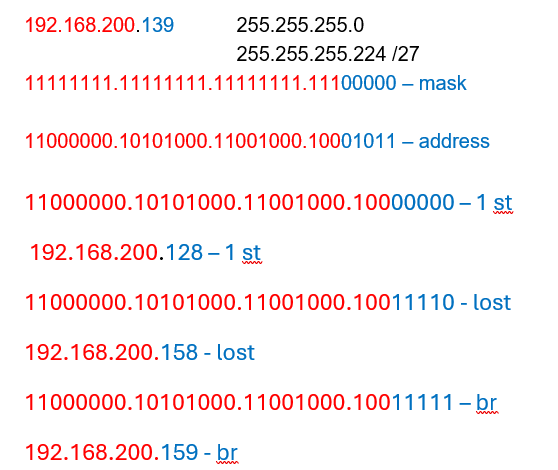

#  Расчет подсетей IPv4

##  	Задачи:

  1. [Определение подсетей по IPv4-адресу;](readme.md#создание-и-настройка-сети)
  2. [Расчет подсетей по IPv4-адресу;](readme.md#изучение-таблицы-мас-адресов-коммутатора)
  
 

###  Проблема 1

## Дано.

|                          |                   |
|--------------------------|-------------------|
| IP-адрес узла:           | 192.168.200.139   | 
| Исходная маска подсети:  | 255.255.255.0     | 
| Новая маска подсети:     | 255.255.255.224   |

№№ Решение:

~~~

192.168.200.139            255.255.255.0
                           255.255.255.224 /27
11111111.11111111.11111111.111 00000 – mask
11000000.10101000.11001000.100 01011 – address 
11000000.10101000.11001000.100 00000 – 1 st
192.168.200.128 – 1 st
11000000.10101000.11001000.100 11110 - lost
192.168.200.158 - lost
11000000.10101000.11001000.100 11111 – br
192.168.200.159 - br

~~~

|-----------------------------------------Найти------------------------------------------|
|--------------------------------------------------------------|-------------------------|
| Количество бит подсети                                       |   K=11                  | 
| Количество созданных подсетей                                |   2^K=2048              | 
| Количество бит узлов в подсети                               |   N=5                   |
| Количество узлов в подсети                                   |   2^N-2=30              | 
| Сетевой адрес этой подсети                                   |   192.168.200.128/27    | 
| IPv4-адрес первого узла в этой подсети                       |   192.168.200.129       |
| IPv4-адрес последнего узла в этой подсети                    |   192.168.200.158       | 
| Широковещательный IPv4-адрес в этой подсети	192.168.200.159  |   192.168.200.159       | 

###  Проблема 2

## Дано.

|--------------------------|-------------------|
| IP-адрес узла:           | 10.101.99.228     | 
| Исходная маска подсети:  | 255.0.0.0         | 
| Новая маска подсети:     | 255.255.128.0     |

№№ Решение:

~~~

10.101.99.228		           255.0.0.0
10.101.99.228		           255.255.128.0/17
11111111.11111111.1 0000000.00000000 - mask
00001010.01100101.0 1100011.11100100 - address
00001010.01100101.0 0000000.00000000 – Networks
10.101.0.0/17
00001010.01100101.0 0000000.00000001 – 1St
10.101.0.1 – 1St
00001010.01100101.0 1111111.11111110 – last
10.101.127.254 – last
00001010.01100101.0 1111111.11111111 – broadcast
10.101.127.255 – broadcast

~~~

|-----------------------------------------Найти------------------------------------------|
|--------------------------------------------------------------|-------------------------|
| Количество бит подсети                                       |   K=1                   | 
| Количество созданных подсетей                                |   2^K=2                 | 
| Количество бит узлов в подсети                               |   N=15                  |
| Количество узлов в подсети                                   |   2^N-2=32766           | 
| Сетевой адрес этой подсети                                   |   10.101.0.0/17         | 
| IPv4-адрес первого узла в этой подсети                       |   10.101.0.1            |
| IPv4-адрес последнего узла в этой подсети                    |   10.101.127.254        | 
| Широковещательный IPv4-адрес в этой подсети	192.168.200.159  |   10.101.127.255        | 

###  Проблема 3

## Дано.

|--------------------------|-------------------|
| IP-адрес узла:           | 172.22.32.12      | 
| Исходная маска подсети:  | 255.255.0.0       | 
| Новая маска подсети:     | 255.255.224.0     |

№№ Решение:

~~~

172.22.32.12/16	    		   255.255.0.0
172.22.32.12/19			       255.255.224.0
11111111.11111111.001 00000.00000000 -mask
11111111.11111111.001 00000.00000000 – networks
172.22.32.0/19
11111111.11111111.001 00000.00000001 - 1St
172.22.32.1 - 1St
11111111.11111111.001 11111.11111110 – lost
172.22.63.254 – lost
11111111.11111111.001 11111.11111111 –br
172.22.63.255 – br	

~~~

|-----------------------------------------Найти------------------------------------------|
|--------------------------------------------------------------|-------------------------|
| Количество бит подсети                                       |   K=3                   | 
| Количество созданных подсетей                                |   2^K=8                 | 
| Количество бит узлов в подсети                               |   N=13                  |
| Количество узлов в подсети                                   |   2^N-2=8190            | 
| Сетевой адрес этой подсети                                   |   172.22.32.0/19        | 
| IPv4-адрес первого узла в этой подсети                       |   172.22.32.1           |
| IPv4-адрес последнего узла в этой подсети                    |   172.22.63.254         | 
| Широковещательный IPv4-адрес в этой подсети	192.168.200.159  |   172.22.63.255         | 

###  Проблема 4

## Дано.

|--------------------------|-------------------|
| IP-адрес узла:           | 192.168.1.245     | 
| Исходная маска подсети:  | 255.255.255.0     | 
| Новая маска подсети:     | 255.255.255.252   |

№№ Решение:

~~~

192.168.1.245	             255.255.255.0
192.168.1.245/30           255.255.255.252
11111111.11111111.11111111.111111 00 – networks
192.168.1.244/30
11111111.11111111.11111111.111111 01 - 1St
192.168.1.245 - 1St
11111111.11111111.11111111.111111 10 – lost
192.168.1.246 – lost
11111111.11111111.11111111.111111 11 -br
192.168.1.247 – br

~~~

|-----------------------------------------Найти------------------------------------------|
|--------------------------------------------------------------|-------------------------|
| Количество бит подсети                                       |   K=14                  | 
| Количество созданных подсетей                                |   2^K=16384             | 
| Количество бит узлов в подсети                               |   N=2                   |
| Количество узлов в подсети                                   |   2^N-2=2               | 
| Сетевой адрес этой подсети                                   |   192.168.1.243/30      | 
| IPv4-адрес первого узла в этой подсети                       |   192.168.1.245         |
| IPv4-адрес последнего узла в этой подсети                    |   192.168.1.246         | 
| Широковещательный IPv4-адрес в этой подсети	192.168.200.159  |   192.168.1.247         | 

###  Проблема 5

## Дано.

|--------------------------|-------------------|
| IP-адрес узла:           | 128.107.0.55      | 
| Исходная маска подсети:  | 255.255.0.0       | 
| Новая маска подсети:     | 255.255.255.0     |

№№ Решение:

~~~

128.107.0.55	             255.255.0.0
128.107.0.55	             255.255.255.0
11111111.11111111.11111111.00000000 – networks
128.107.0.0/24
11111111.11111111.11111111.00000001 - 1St
128.107.0.1 - 1St
11111111.11111111.11111111.11111110 - lost
128.107.0.254 - lost
11111111.11111111.11111111.11111111 – br
128.107.0.255 – br

~~~

|-----------------------------------------Найти------------------------------------------|
|--------------------------------------------------------------|-------------------------|
| Количество бит подсети                                       |   K=8                   | 
| Количество созданных подсетей                                |   2^K=256               | 
| Количество бит узлов в подсети                               |   N=8                   |
| Количество узлов в подсети                                   |   2^N-2=254             | 
| Сетевой адрес этой подсети                                   |   128.107.0.0/24        | 
| IPv4-адрес первого узла в этой подсети                       |   128.107.0.1           |
| IPv4-адрес последнего узла в этой подсети                    |   128.107.0.254         | 
| Широковещательный IPv4-адрес в этой подсети	192.168.200.159  |   128.107.0.255         | 

###  Проблема 6

## Дано.

|--------------------------|-------------------|
| IP-адрес узла:           | 192.135.250.180   | 
| Исходная маска подсети:  | 255.255.255.0     | 
| Новая маска подсети:     | 255.255.255.248   |

№№ Решение:

~~~

192.135.250.180	           255.255.255.0
                           255.255.255.248
11111111.11111111.11111111.11111000 – mask
11000000.10000111.11111010.10110000 -networks
192.135.250.176/29
11000000.10000111.11111010.10110001 -  1St
192.135.250.177 -  1St
11000000.10000111.11111010.10110110 – lost
192.135.250.182 - lost
11000000.10000111.11111010.10110111 -br
192.135.250.183 -br

~~~

|-----------------------------------------Найти------------------------------------------|
|--------------------------------------------------------------|-------------------------|
| Количество бит подсети                                       |   K=13                  | 
| Количество созданных подсетей                                |   2^K=8192              | 
| Количество бит узлов в подсети                               |   N=3                   |
| Количество узлов в подсети                                   |   2^N-2=6               | 
| Сетевой адрес этой подсети                                   |   192.135.250.176/29    | 
| IPv4-адрес первого узла в этой подсети                       |   192.135.250.177       |
| IPv4-адрес последнего узла в этой подсети                    |   192.135.250.182       | 
| Широковещательный IPv4-адрес в этой подсети	192.168.200.159  |   192.135.250.183       | 

