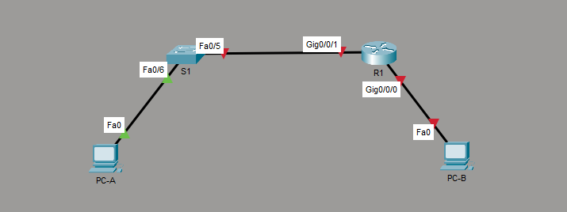
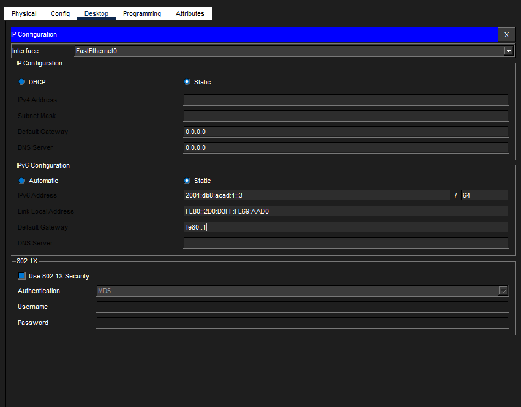

#  Настройка IPv6-адресов на сетевых устройствах 
## Топология:

## Таблица адресации.

| Устройство   | Интерфейс   | IPv6-адрес            | Link local IPv6-адрес | Длина префикса | Шлюз по умолчанию |
|-------------:|:------------|----------------------:|----------------------:|---------------:|------------------:|
| R1           | g0/0        | 2001:db8:acad:a::11    | fe80::1               | 64             | -|
|              | g0/1        | 2001:db8:acad:1::11    | fe80::1               | 64             | -|
| S1           | VLAN 1      | 2001:db8:acad:1::b    | fe80::b               | 64             | -|
| PC-A         | NIC         | 2001:db8:acad:1::3    | SLACC                 | 64             |  fe80::1 |
| PC-B         | NIC         | 2001:db8:acad:a::3    | SLACC                 | 64             |  fe80::1 |

###  	Задачи:

  1. [Настройка топологии и конфигурация основных параметров маршрутизатора и коммутатора;](readme.md#Настройка-топологии-и-конфигурация-основных-параметров-маршрутизатора-и-коммутатор)
  2. [Ручная настройка IPv6-адресов;](readme.md#Ручная-настройка-IPv6-адресов)
  3. [Проверка сквозного соединения;](readme.md#Проверка-сквозного-соединения)
  
 

###  Создание и настройка сети:

####  Настройка топологии и конфигурация основных параметров маршрутизатора и коммутатора

##### Настройте маршрутизатор:
~~~
R1(config)#
R1(config)#
R1(config)#no ip domain-lookup
R1(config)#
R1(config)#
R1(config)#
R1(config)#
R1(config)#en
R1(config)#ena
R1(config)#enable se
R1(config)#enable secret class
R1(config)#li
R1(config)#lin
R1(config)#line co
R1(config)#line console 0
R1(config-line)#
R1(config-line)#
R1(config-line)#
R1(config-line)#
R1(config-line)#log
R1(config-line)#logh
R1(config-line)#logg
R1(config-line)#logging sy
R1(config-line)#logging synchronous 
R1(config-line)#pas
R1(config-line)#password cisco
R1(config-line)#
R1(config-line)#
R1(config-line)#
R1(config-line)#lo
R1(config-line)#log
R1(config-line)#login
R1(config-line)#login 
R1(config-line)#lin
R1(config-line)#line vty 0 4
R1(config-line)#pass
R1(config-line)#password cisco
R1(config-line)#
R1(config-line)#
R1(config-line)#tr
R1(config-line)#transport in
R1(config-line)#transport input ss
R1(config-line)#transport input ssh t
R1(config-line)#transport input ssh te
R1(config-line)#transport input ssh te?
% Unrecognized command
R1(config-line)#transport input ssh ?
  <cr>
R1(config-line)#transport input ?
  all     All protocols
  none    No protocols
  ssh     TCP/IP SSH protocol
  telnet  TCP/IP Telnet protocol
R1(config-line)#transport input all
R1(config-line)#exit
R1(config)#se
R1(config)#ser
R1(config)#service pa
R1(config)#service password-encryption 
R1(config)#end
R1#
%SYS-5-CONFIG_I: Configured from console by console

R1#cop
R1#copy r
R1#copy running-config 
R1#copy running-config s
R1#copy running-config st
R1#copy running-config startup-config 
Destination filename [startup-config]? 
Building configuration...
[OK]
R1#

~~~

##### Настройте коммутатор:

~~~
Switch>
Switch>en
Switch#conf t
Enter configuration commands, one per line.  End with CNTL/Z.
Switch(config)#
Switch(config)#
Switch(config)#
Switch(config)#
Switch(config)#
Switch(config)#hos
Switch(config)#hostname S1
S1(config)#
S1(config)#
S1(config)#en
S1(config)#ena
S1(config)#enable s
S1(config)#enable secret class
S1(config)#
S1(config)#
S1(config)#line co
S1(config)#line console 0
S1(config-line)#logg
S1(config-line)#logging 
S1(config-line)#logging synchronous 
S1(config-line)#pas
S1(config-line)#password cisco
S1(config-line)#
S1(config-line)#
S1(config-line)#
S1(config-line)#log
S1(config-line)#logi
S1(config-line)#login 
S1(config-line)#
S1(config-line)#
S1(config-line)#
S1(config-line)#line
S1(config-line)#line vty 0 4
S1(config-line)#pass
S1(config-line)#password cisco
S1(config-line)#
S1(config-line)#
S1(config-line)#
S1(config-line)#
S1(config-line)#log
S1(config-line)#logi
S1(config-line)#login 
S1(config-line)#
S1(config-line)#
S1(config-line)#
S1(config-line)#tra
S1(config-line)#transport i
S1(config-line)#transport input all
S1(config-line)#
S1(config-line)#
S1(config-line)#
S1(config-line)#
S1(config-line)#end
S1#
%SYS-5-CONFIG_I: Configured from console by console

S1#copy ru
S1#copy running-config st
S1#copy running-config startup-config 
Destination filename [startup-config]? 
Building configuration...
[OK]
S1#
S1#
~~~

### Ручная настройка IPv6-адресов;

#### Назначьте IPv6-адреса интерфейсам Ethernet на R1:

~~~

R1(config)#
R1(config)#
R1(config)#
R1(config)#sho
R1(config)#int
R1(config)#interface gi?
GigabitEthernet  
R1(config)#interface gi
R1(config)#interface gigabitEthernet ?
  <0-9>  GigabitEthernet interface number
R1(config)#interface gigabitEthernet 0?
/  
R1(config)#interface gigabitEthernet 0/0/1
R1(config-if)#ip
R1(config-if)#ip?
ip  ipv6  
R1(config-if)#ipv
R1(config-if)#ipv6 ad
R1(config-if)#ipv6 address 2001:db8:acad:1::1
% Incomplete command.
R1(config-if)#?
  arp                Set arp type (arpa, probe, snap) or timeout
  bandwidth          Set bandwidth informational parameter
  cdp                CDP interface subcommands
  channel-group      Add this interface to an Etherchannel group
  crypto             Encryption/Decryption commands
  custom-queue-list  Assign a custom queue list to an interface
  delay              Specify interface throughput delay
  description        Interface specific description
  duplex             Configure duplex operation.
  exit               Exit from interface configuration mode
  fair-queue         Enable Fair Queuing on an Interface
  hold-queue         Set hold queue depth
  ip                 Interface Internet Protocol config commands
  ipv6               IPv6 interface subcommands
  lldp               LLDP interface subcommands
  mac-address        Manually set interface MAC address
  mtu                Set the interface Maximum Transmission Unit (MTU)
  no                 Negate a command or set its defaults
  pppoe              pppoe interface subcommands
  pppoe-client       pppoe client
  priority-group     Assign a priority group to an interface
  service-policy     Configure QoS Service Policy
  shutdown           Shutdown the selected interface
  speed              Configure speed operation.
  standby            HSRP interface configuration commands
  tx-ring-limit      Configure PA level transmit ring limit
  zone-member        Apply zone name
R1(config-if)#ipv6 address?
address  
R1(config-if)#ipv6 address 2001:db8:acad:1::11/64
R1(config-if)#in
R1(config-if)#in?
% Unrecognized command
R1(config-if)#exit
R1(config)#in
R1(config)#interface g
R1(config)#interface gigabitEthernet 0
R1(config)#interface gigabitEthernet 0?
/  
R1(config)#interface gigabitEthernet 0/0?
/  .  
R1(config)#interface gigabitEthernet 0/0/0
R1(config-if)#ipv
R1(config-if)#ipv6 ad
R1(config-if)#ipv6 address 2001:db8:acad:a::11/64
R1(config-if)#
R1(config-if)#
R1(config-if)#
R1(config-if)#
R1(config-if)#
R1(config-if)#
R1(config-if)#end
R1#
~~~

~~~
R1#show ipv6 interface brief 
GigabitEthernet0/0/0       [administratively down/down]
    FE80::2D0:58FF:FE62:8601
    2001:DB8:ACAD:A::1
GigabitEthernet0/0/1       [administratively down/down]
    FE80::2D0:58FF:FE62:8602
    2001:DB8:ACAD:1::1
Vlan1                      [administratively down/down]
    unassigned
~~~
Забыл включить интерйфейсы.
~~~
R1#conf t
Enter configuration commands, one per line.  End with CNTL/Z.
R1(config)#
R1(config)#
R1(config)#
R1(config)#
R1(config)#in
R1(config)#interface gi
R1(config)#interface gigabitEthernet 0/0/0
R1(config-if)#no
R1(config-if)#no sh
R1(config-if)#no shutdown 

R1(config-if)#
%LINK-5-CHANGED: Interface GigabitEthernet0/0/0, changed state to up

%LINEPROTO-5-UPDOWN: Line protocol on Interface GigabitEthernet0/0/0, changed state to up

R1(config-if)#
R1(config-if)#exit
R1(config)#
R1(config)#
R1(config)#int
R1(config)#interface gig
R1(config)#interface gigabitEthernet 0/0/1
R1(config-if)#
R1(config-if)#
R1(config-if)#
R1(config-if)#no sh
R1(config-if)#no shutdown 

R1(config-if)#
%LINK-5-CHANGED: Interface GigabitEthernet0/0/1, changed state to up

%LINEPROTO-5-UPDOWN: Line protocol on Interface GigabitEthernet0/0/1, changed state to up

R1(config-if)#
R1(config-if)#
R1(config-if)#
R1(config-if)#end
R1#
%SYS-5-CONFIG_I: Configured from console by console

R1#sh
R1#show ipv
R1#show ipv6 in
R1#show ipv6 int
R1#show ipv6 interface vr
R1#show ipv6 interface br
R1#show ipv6 interface brief 
GigabitEthernet0/0/0       [up/up]
    FE80::2D0:58FF:FE62:8601
    2001:DB8:ACAD:A::11
GigabitEthernet0/0/1       [up/up]
    FE80::2D0:58FF:FE62:8602
    2001:DB8:ACAD:1::11
Vlan1                      [administratively down/down]
    unassigned
R1#

~~~
Какие группы многоадресной рассылки назначены интерфейсу G0/0?

~~~
GigabitEthernet0/0/0       
    FE80::2D0:58FF:FE62:8601
    2001:DB8:ACAD:A::11
GigabitEthernet0/0/1       
    FE80::2D0:58FF:FE62:8602
    2001:DB8:ACAD:1::11
~~~
Не прописал локальный адрес 

~~~
R1(config)#interface gigabitEthernet 0/0/0
R1(config-if)#ipv
R1(config-if)#ipv6 fe80::1?
% Unrecognized command
R1(config-if)#ipv6 fe80::1 ?
% Unrecognized command
R1(config-if)#ipv6 ad
R1(config-if)#ipv6 address fe80::1?
WORD  X:X:X:X::X  X:X:X:X::X/<0-128>  
R1(config-if)#ipv6 address fe80::1 ?
  link-local  Use link-local address
R1(config-if)#ipv6 address fe80::1 li
R1(config-if)#ipv6 address fe80::1 link-local
R1(config-if)#exit
R1(config-if)#interface gigabitEthernet 0/0/1
R1(config-if)#ipv6 address fe80::1 link-local
R1(config-if)#end
~~~

~~~
R1#
R1#
R1#sh
R1#show ipv
R1#show ipv6 in
R1#show ipv6 int
R1#show ipv6 interface brie
GigabitEthernet0/0/0       [up/up]
    FE80::1
    2001:DB8:ACAD:A::11
GigabitEthernet0/0/1       [up/up]
    FE80::1
    2001:DB8:ACAD:1::11
~~~

####  Активируйте IPv6-маршрутизацию на R1

~~~
FastEthernet0 Connection:(default port)

   Connection-specific DNS Suffix..: 
   Link-local IPv6 Address.........: FE80::2D0:BAFF:FECA:8445
   IPv6 Address....................: ::
   IPv4 Address....................: 0.0.0.0
   Subnet Mask.....................: 0.0.0.0
   Default Gateway.................: FE80::2D0:58FF:FE62:8601
                                     0.0.0.0

~~~
##### Активация:
~~~
User Access Verification

Password: 

R1>en
Password: 
R1#conf t
Enter configuration commands, one per line.  End with CNTL/Z.
R1(config)#
R1(config)#ip
R1(config)#ipv
R1(config)#ipv6 u
R1(config)#ipv6 unicast-routing 
R1(config)#
~~~
~~~
FastEthernet0 Connection:(default port)

   Connection-specific DNS Suffix..: 
   Link-local IPv6 Address.........: FE80::2D0:BAFF:FECA:8445
   IPv6 Address....................: 2001:DB8:ACAD:A:2D0:BAFF:FECA:8445
   IPv4 Address....................: 0.0.0.0
   Subnet Mask.....................: 0.0.0.0
   Default Gateway.................: FE80::2D0:58FF:FE62:8601
                                     0.0.0.0
~~~

#### Назначьте IPv6-адреса интерфейсу управления (SVI) на S1

~~~
S1(config)#int
S1(config)#interface vl
S1(config)#interface vlan 1
S1(config)#interface vlan 1
S1(config-if)#ipv
S1(config-if)#ipv6 ad
S1(config-if)#ipv6 address 2001:db8:acad:1::b
% Incomplete command.
S1(config-if)#ipv6 address 2001:db8:acad:1::b/64
S1(config-if)#ipv6 address fe80::b l
S1(config-if)#ipv6 address fe80::b link-local 
S1(config-if)#end
~~~

~~~
S1#show ipv6 interface vlan
S1#show ipv6 interface vlan 1
Vlan1 is administratively down, line protocol is down
  IPv6 is tentative, link-local address is FE80::B [TEN]
  No Virtual link-local address(es):
  Global unicast address(es):
    2001:DB8:ACAD:1::B, subnet is 2001:DB8:ACAD:1::/64 [TEN]
  Joined group address(es):
    FF02::1
  MTU is 1500 bytes
  ICMP error messages limited to one every 100 milliseconds
  ICMP redirects are enabled
  ICMP unreachables are sent
  Output features: Check hwidb
  ND DAD is enabled, number of DAD attempts: 1
  ND reachable time is 30000 milliseconds
~~~

#### Назначьте компьютерам статические IPv6-адреса

~~~
   Connection-specific DNS Suffix..: 
   Link-local IPv6 Address.........: FE80::2D0:BAFF:FECA:8445
   IPv6 Address....................: 2001:DB8:ACAD:A::3
   IPv4 Address....................: 0.0.0.0
   Subnet Mask.....................: 0.0.0.0
   Default Gateway.................: FE80::1
                                     0.0.0.0
~~~

###  Проверка сквозного подключения

#### С PC-A отправьте эхо-запрос на FE80::1. Это локальный адрес канала, назначенный G0/1 на R1.
~~~

C:\>ping FE80::1

Pinging FE80::1 with 32 bytes of data:

Reply from FE80::1: bytes=32 time<1ms TTL=255
Reply from FE80::1: bytes=32 time<1ms TTL=255
Reply from FE80::1: bytes=32 time<1ms TTL=255
Reply from FE80::1: bytes=32 time=2ms TTL=255

~~~
#### Отправьте эхо-запрос на интерфейс управления S1 с PC-A
~~~
C:\>ping 2001:db8:acad:1::b

Pinging 2001:db8:acad:1::b with 32 bytes of data:

Reply from 2001:DB8:ACAD:1::B: bytes=32 time<1ms TTL=255
Reply from 2001:DB8:ACAD:1::B: bytes=32 time<1ms TTL=255
Reply from 2001:DB8:ACAD:1::B: bytes=32 time<1ms TTL=255
Reply from 2001:DB8:ACAD:1::B: bytes=32 time<1ms TTL=255

Ping statistics for 2001:DB8:ACAD:1::B:
    Packets: Sent = 4, Received = 4, Lost = 0 (0% loss),
Approximate round trip times in milli-seconds:
    Minimum = 0ms, Maximum = 0ms, Average = 0ms
~~~

#### Введите команду tracert на PC-A, чтобы проверить наличие сквозного подключения к PC-B.
~~~
C:\>tracert 2001:db8:acad:1::3

Tracing route to 2001:db8:acad:1::3 over a maximum of 30 hops: 

  1   1 ms      0 ms      0 ms      2001:DB8:ACAD:A::11
  2   0 ms      0 ms      0 ms      2001:DB8:ACAD:1::3

~~~

